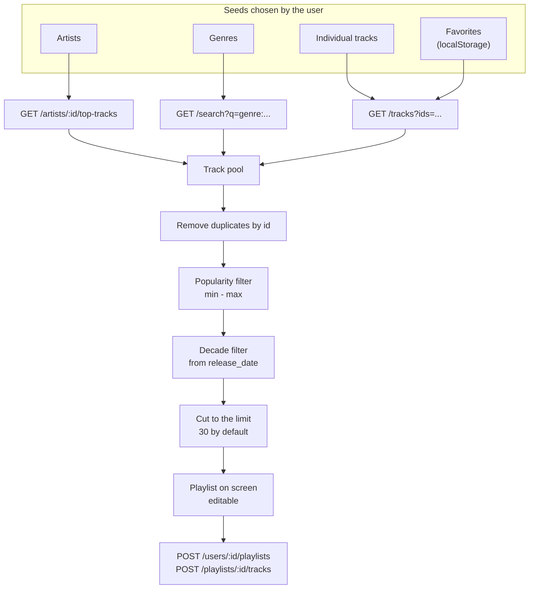
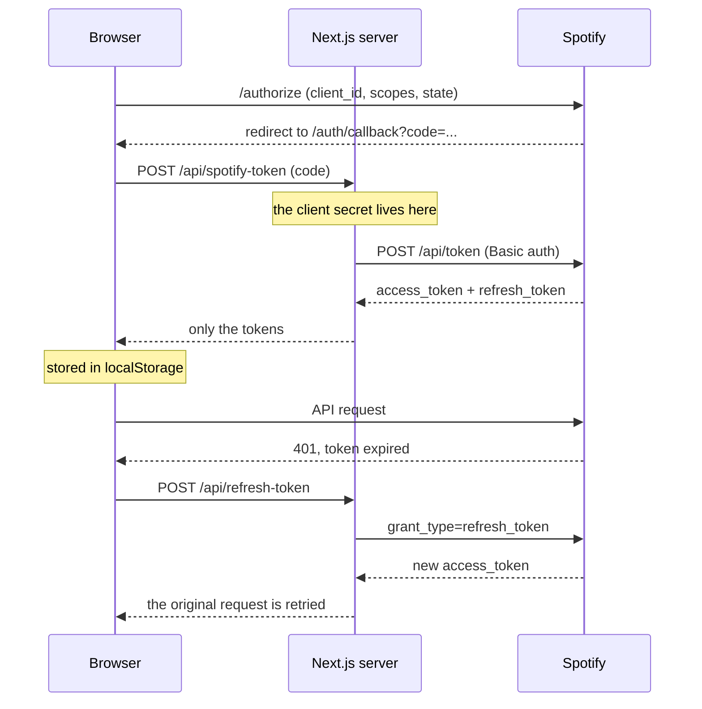

# Pinchadiscos

*[Versión en español](README.es.md)*

*You set the mood, it spins the set.* (*Pinchadiscos* is Spanish slang for DJ.)

A Next.js web app that builds Spotify playlists from a handful of filters: artists, genres, decades, popularity and number of tracks. You can review the playlist in the browser and then save it to the user's real Spotify account.

Final project for the Web Programming course at U-tad.

## What it does

* Spotify login via OAuth 2.0 (authorization code flow) with automatic token refresh.
* Search widgets to pick specific artists and tracks, with autocomplete on the Spotify API.
* Filters by genre (19 available), by decade (from the 70s to the 2020s) and by popularity range.
* Playlist generation that combines the chosen seeds, removes duplicates and applies the filters locally.
* Mark tracks as favorites (stored in the browser) so they're included in later generations.
* Add more tracks, remove the ones that don't fit and save the result as a new playlist on Spotify.

## How it works

Spotify retired its recommendations endpoint, so Pinchadiscos doesn't ask for a ready-made playlist: it fires several searches in parallel from the seeds you choose, gathers everything into a pool and applies the filters locally.



The client secret never reaches the browser: exchanging the code for tokens and refreshing them go through server routes.



## Stack

Next.js 16 (App Router), React 19, Tailwind CSS 4 and the Spotify Web API. The token exchange goes through two server routes (`/api/spotify-token` and `/api/refresh-token`) so the client secret is never exposed in the browser.

## Getting started

You need Node.js 18 or later and an app created in the [Spotify developer dashboard](https://developer.spotify.com/dashboard).

In your Spotify app settings, add this Redirect URI:

```
http://127.0.0.1:3000/auth/callback
```

Then, in the project:

```bash
npm install
cp .env.example .env.local
```

Fill in `.env.local` with your app's credentials:

```
SPOTIFY_CLIENT_ID=...
SPOTIFY_CLIENT_SECRET=...
NEXT_PUBLIC_SPOTIFY_CLIENT_ID=...
NEXT_PUBLIC_REDIRECT_URI=http://127.0.0.1:3000/auth/callback
```

And start the server:

```bash
npm run dev
```

The app runs at `http://127.0.0.1:3000`. Keep in mind that Spotify apps in development mode only work with the accounts you add manually in the Users section of the dashboard.

## Structure

```
src/
  app/
    page.js               login screen
    dashboard/            main screen with the filters and the playlist
    auth/callback/        receives the code from Spotify and exchanges it for the token
    api/                  server routes to request and refresh tokens
  components/
    widgets/              one component per filter
    TrackCard.jsx         track card with favorite, preview and remove
    PlaylistDisplay.jsx   list of the generated playlist
  lib/
    auth.js               OAuth, token storage and refresh
    spotify.js            API calls and generation logic
    favorites.js          favorites in localStorage
```

## Known limitations

* The mood filter (`MoodWidget`) was never wired into generation. Spotify retired the audio features endpoint needed to compute it, so the component is in the repo but unused.
* Audio previews depend on `preview_url`, which Spotify no longer returns for every track. When it's missing, the button says there's no preview.
* Favorites live in the browser's `localStorage`, not in the Spotify account.

## License

MIT. See [LICENSE](LICENSE).
